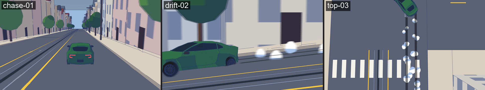

# video-harness

A command-line harness that turns a **shot spec** (a JSON file) into a finished, stylised video with sound. It drives Blender, Krita, SoX, Inkscape and ffmpeg headless, with no screen attached. The idea is that an AI only writes and revises the spec; ordinary, fixed, tested code does everything else.

**Status in one paragraph.** Milestones M0 to M2 of a six-milestone plan are built and verified: tooling, a painted 2.5D environment shot, and a three-shot 3D toon street scene with a car, smoke, tyre marks, sound, subtitles and loudness-normalised mix. The pipeline, cache and automatic checks work and are tested. **The visual quality is well short of the painted-anime reference that motivated the project** (see [Findings](#findings)). M3 to M5 (full checker set, an AI "Director" that writes specs from a brief, characters) are not built.

Everything here was built by Claude Code working from a written build spec ([docs/spec.md](docs/spec.md)), with the owner reviewing at milestone gates.

---

## Demo outputs

| Milestone | What it is | Files |
|---|---|---|
| M1 | One painted environment shot: layered sky and rooftops, camera drifts, 5.000 s, exactly 120 frames, 1920x1080 | [video](docs/demo/m1-rooftops.mp4), [contact sheet](docs/demo/m1-contact.png) |
| M2 | Three shots (rear chase, side drift, top-down), 6.50 s, 156 frames, 1920x1080 at 24 fps, with music, sound cues and a subtitle; -13.7 LUFS | [video](docs/demo/m2-street.mp4), [contact sheet](docs/demo/m2-contact.png), [check report](docs/demo/m2-report.json) |



The M1 clip was rendered before later changes to the render scripts and has not been re-rendered since; see [Known gaps](#known-gaps).

---

## Why it is built this way

Three rules, taken from the spec and enforced in code:

1. **Spec, not code.** At run time the AI emits spec fields only. It never writes Blender or Krita scripts on the fly. Tool scripts (`toolscripts/`) are fixed Python files that read a job JSON and write a result JSON. A shot that needs something new gets a new, typed spec field, never a one-off script.
2. **Every stage is cached.** Stage key = hash of that stage's spec fields + upstream key + tool version + script hashes. Change one field and only the dependent stages re-run.
3. **Every render is checked.** Nothing is reported done until automatic checks pass and a contact sheet exists. A failing check names the check, the shot and the spec field. Thresholds live in `config/checks.json` and are never loosened to make a check pass.

Flow: `validator -> planner -> adapters -> checkers -> assembler -> report`. **Adapters (`src/adapters/`) are the only code that starts a tool**, so every process launch, timeout and crash policy lives in one place.

### Pipeline stages

`paint` (Krita) -> `build` set -> `place` assets -> `animate` -> `render` (+ ID pass) in Blender -> `sound` (SoX, ffmpeg) -> `assemble` (ffmpeg).

Each stage writes to `.cache/stages/<stage>/<key>/` with a `done.json` manifest listing every output file and its size. A cache hit is valid only if every listed file is present and matches. Writes go to per-process temp dirs and are renamed into place under a per-key lock.

### A shot spec

```json
{
  "id": "chase-01",
  "duration": 2.5,
  "location": { "name": "hill-street", "time": "afternoon" },
  "camera": { "move": "chase", "follow": "car", "distance": 7, "height": 2.2, "lens": 50 },
  "actors": [ { "asset": "coupe-green", "name": "car", "path": "lane-right", "speed": 24 } ],
  "effects": { "motionBlur": 0.6 },
  "sound": [ { "cue": "engine", "at": 0, "level": "high" } ]
}
```

Assets are folders with a manifest (vehicles, locations, styles). Named paths such as `lane-right` keep specs short: the AI picks a path, it does not invent coordinates. Every spec field has a type, a default, a range and a validator test. The validator also does geometry: for painted locations it computes how far the camera can move before it sees past the painted edge, and rejects specs that would.

Full example projects: [`projects/m1-rooftops`](projects/m1-rooftops/project.json) and [`projects/m2-street`](projects/m2-street/project.json).

### Commands

```
node src/cli/main.ts <command> [args] [--json]

doctor                  run a smoke test for each of the six tools
init <project>          create a project skeleton
validate <project>      check the spec (types, ranges, asset references, geometry)
paint <location>        paint a location's layers in Krita
build <project> [shot]  paint + build set + place assets + animate
preview <project> [shot]  fast low-resolution render
render <project> [shot] full-quality render (+ ID pass when a shot has actors)
check <project> [shot]  run the checkers; writes out/report.json and out/contact.png
assemble <project>      checks first, then music, cues, subtitles, loudnorm, final mp4
status <project>        show which stages are cached for each shot
```

Exit code 0 only on success; on failure, one line naming what failed and which spec field. `--json` gives machine-readable output. `render` and `assemble` refuse to run if validation or checks fail.

### Checkers (5 of the 8 in the spec are built)

| Check | What it measures | Status |
|---|---|---|
| shot-length | frame count equals duration x fps | built |
| frame-not-empty | image variance and a scan for missing-texture colours, over sampled frames | built |
| subject-visible | per-actor pixel count from a flat-colour **ID pass** rendered alongside the image | built |
| ground-present | ID-pass ground pixels beneath each actor in every frame | built |
| repeatable | renders frames 1..N twice in separate Blender processes and compares file hashes; on mismatch says whether decoded pixels or only file bytes differ | built |
| camera-clear | camera vs set geometry | planned (M3) |
| motion-speed | mean pixel motion between frames against a cap per move | planned (M3) |
| loudness | ffmpeg two-pass loudnorm on the final mix; target -14 LUFS +/- 1, true peak <= -1 dB | enforced by `assemble` and tested in the M2 end-to-end test; not yet a standalone checker |

---

## What was built, by milestone

### M0: tooling
One install script (`scripts/install-tools.sh`) that downloads Blender, Krita, Inkscape, SoX and Rhubarb from their official sources into `.tools/` (nothing outside the repo, no admin rights) and records versions and checksums in `tools.lock.json`. `harness doctor` runs a real smoke test per tool: render a cube headless, paint a layered Krita document, convert an SVG, encode a clip with sound, synthesise a tone, run lip-sync analysis.

Pinned: Blender 5.2.4, Krita 5.3.4.1, Inkscape 1.4.4, SoX 14.4.2, Rhubarb 1.14.0, ffmpeg 9.0.2. **ffmpeg is the exception**: it is taken from the machine's existing system install (winget `Gyan.FFmpeg`), so its version is recorded but not checksummed or installed by the script.

### M1: one painted environment shot
A Krita script paints a layered sky-and-rooftops city; Blender places each layer as an unlit plane at its own depth and drifts the camera. **Parallax was measured, not just looked at**: cross-correlating image bands between first and last frame (camera travel 5.95 m) gave clouds 17 px, far city 55 px, mid rows 136 px, near rows about 367 px, against a geometric prediction of 17 / 55 / 136 / 350. Nearer layers move more, in proportion to 1/depth. Full note: [docs/milestones/M1.md](docs/milestones/M1.md).

### M2: a car on a 3D street, with sound
- A scripted hill-street set (`toolscripts/blender/sets/street.py`): buildings, trees, poles, kerbs, lane markings, sloped ground.
- Toon shading (diffuse -> Shader-to-RGB -> constant colour ramp -> emission) and Freestyle outlines.
- A car from a CC0 model: wheel rigging, path following, drift slip maths, tyre-mark ribbons that appear as the car passes, smoke puffs, speed lines, motion blur.
- Chase, side-track and top-down cameras.
- Sound: SoX-synthesised cues (engine, screech, whoosh, thump, click), a synthesised music bed, ffmpeg mix, burned-in subtitles, two-pass loudnorm to -14 LUFS / -1.5 dB true peak.
- Result: 6.50 s, 156 frames, **15 of 15 checks pass**, measured -13.7 LUFS, -2.9 dBFS true peak. The M2 end-to-end test passes 4/4. Full note: [docs/milestones/M2.md](docs/milestones/M2.md).

---

## Findings

### 1. The quality gap to the reference is large, and it is about the approach, not polish
The target was a 53 s painted-anime clip (not included here). Compared side by side, the harness output differs in kind:

| Reference has | Harness output has |
|---|---|
| Painterly rendering: brush texture, dappled sunlight through trees, warm grading, soft depth of field | Flat toon shading with thin outlines |
| Characters with faces, expressions, hair, clothing, lip-synced dialogue (most of the shots) | No characters (scoped to M5) |
| A detailed, recognisable car: grille, brake discs, rims, a wheel close-up with smoke | A low-poly CC0 coupe |
| Specific, dense places: bay-view interior, gated mansion, vans parked on a hill | A generic street of boxes and round trees |
| Close-ups, in-car, over-the-shoulder shots | Three simple cameras |

Blender's toon shading, scripted Krita painting, SoX and ffmpeg can produce a clean stylised 3D look. They cannot produce hand-painted, character-driven frames without a large amount of authored art. The reference reads like generated imagery rather than a render, so a pure render pipeline was never going to get close. The spec anticipated a gap here (an image-model step behind the same `paint` interface is noted in its section 11). We have not tried one.

### 2. The architecture worked; the look is the weak part
The spec-not-code rule, the stage cache, the ID-pass checkers and the deterministic render all did what they were designed to do. A bad spec is rejected before any pixel is rendered, and a changed field re-runs only what depends on it. This part transfers to any look, including one produced by an image or video model.

### 3. Consumer-hardware performance is the main practical limit
Measured on an i7-10750H laptop with 16 GB RAM and an Intel UHD iGPU only (no NVIDIA):

| Work | Time |
|---|---|
| EEVEE first-frame shader compile | about 100 s on **every** Blender launch (Vulkan and parallel compilation did not help) |
| Painted-plane frames (M1) | about 4 s/frame at 1080p |
| Lit toon set with shadows and Freestyle (M2) | about 13 s/frame at 1080p, 8 samples |
| M1 full render | 497 s for 5 s of video |
| M2 cold, all stages and checks | about an hour for 6.5 s of video |

Two Blender processes at once on the same iGPU slow each other roughly 7x (13 s to 95 s per frame), so they run one after the other. A discrete GPU would change this picture considerably; we did not have one to test.

### 4. Things that behave differently in a real scene than in an isolated test
- Per-object alpha via Object Info colour/alpha and Attribute (Object) nodes was unreliable in EEVEE here, so smoke fades by scale with a constant-alpha material instead of fading in alpha.
- Track-To constraint billboards did not render in the real scene; puffs are keyed to face the camera per frame.
- Freestyle drew lines through geometry below the ground until building boxes were made to follow the ground plane.

### 5. Determinism took three separate fixes
The "render a frame twice, compare hashes" check failed three different ways, each for a different reason:
1. **PNG metadata.** Blender stamps date, render time and the absolute .blend path into the PNG. Identical pixels gave different files. Fix: disable every `use_stamp*` option. The checker now reports whether pixels or only file bytes differ.
2. **A lone frame is not the same as that frame in sequence.** Rendering frame 30 alone differed from frame 30 of the full render by 1/255 on about two pixels out of 2 million. Fix: the check renders frames 1..N in order, like the full render. Both runs now also match the stored frame.
3. **GPU contention and a driver crash.** Running the two check renders in parallel pushed them past the timeout. Separately, Intel's OpenGL driver (`ig9icd64.dll`) can crash with an access violation during Blender's *exit*, after the result file has been written. The adapter accepts that exit code only if the log shows Blender finished and a fresh result file exists; any other non-zero exit still fails.

### 6. Headless Krita is fragile
`doc.exportImage()` to PNG opens a modal options dialog, so headless Krita sat idle forever. The cause was found by listing the process's windows rather than by guessing. Fix: write PNGs with Qt from the document projection and keep batch mode on. An empty `QT_QPA_PLATFORM` also hangs and `offscreen` segfaults.

### 7. A cache is only as good as its failure handling
Two overlapping runs once shared a temp dir; one deleted the other's PNGs and the survivor committed a cache entry with no layer files. The cache now records every output file with its size, uses per-process temp dirs and per-key locks, and has regression tests.

---

## Known gaps

- **M3 to M5 are not built.** M3: remaining checkers (camera-clear, motion-speed, standalone loudness), a `clean` command, preview polish. M4: a Director that turns a two-sentence brief into a valid 4 to 6 shot spec using a language model with schema-constrained output and automatic retry. M5: an MCP server exposing the ten commands, and a rigged character with walk/sit/wave, face sprites and lip sync.
- **M1 was not re-verified after later script changes.** The render and build scripts changed after M1 passed, which invalidates its cache; it needs about a 12-minute re-render and a re-run of its end-to-end test.
- **Smoke fades by shrinking, not by alpha** (see finding 4).
- **The M2 video is short and plain**: 6.5 s, one car, no characters, a generic street.
- **No licence has been chosen for the code.** Third-party assets are CC0 and listed in [assets/ASSETS.md](assets/ASSETS.md).

## Possible next steps
1. Add a painterly post-process (paper and brush texture, grain that flickers rather than swims, grading, bloom, depth of field) and dappled shadows. This stays inside the spec and is the cheapest visible improvement.
2. Put an image or video generation model behind the `paint` interface for hero shots, keeping the harness for validation, caching, checks, sound and assembly. This is the likeliest route to the reference look, and the biggest departure from the spec.
3. Build characters (M5) with simple stylised rigs; expect a game-cutscene look rather than the painted one.
4. Test on a machine with a discrete GPU to see how much of the cost is hardware.

---

## Running it

Requirements: Windows 11 (developed and tested here; other platforms untested), Node 24+, Git Bash, ffmpeg on the PATH (for example `winget install Gyan.FFmpeg`), and disk space for the tools (the downloaded archives alone are about 0.85 GB; extracted copies need more).

```
bash scripts/install-tools.sh         # downloads the other five pinned tools into .tools/
npm install
node src/cli/main.ts doctor           # six smoke tests
node src/cli/main.ts validate m2-street
node src/cli/main.ts render m2-street # about an hour cold on an Intel iGPU
node src/cli/main.ts check m2-street
node src/cli/main.ts assemble m2-street   # projects/m2-street/out/m2-street.mp4

npm test                              # 32 unit tests
npm run typecheck
npm run test:e2e                      # M0, M1, M2 acceptance tests (slow when the cache is cold)
```

TypeScript runs directly on Node 25 (type stripping; erasable syntax only). Tool scripts are Python run inside Blender and Krita.

## Repository layout

```
src/cli/           commands, result formatting, doctor
src/spec/          schema, defaults, ranges, validator, asset loading
src/planner/       stage cache (keys, manifests, locks)
src/pipeline/      paint, shot (build/place/animate/render/encode), sound
src/adapters/      the only code that starts Blender, Krita, ffmpeg, SoX, Rhubarb, Inkscape
src/checkers/      the checkers and the report/contact-sheet writer
toolscripts/       fixed Python: blender/ (set, animate, render, id_pass, toon, fx...) and krita/
assets/            vehicles, locations, styles, ASSETS.md (sources and licences)
projects/          example specs (m1-rooftops, m2-street)
config/checks.json check thresholds
docs/              spec.md, milestone notes, demo outputs
tests/             unit and end-to-end (one per milestone)
```

## Licences of third-party material
- Car model: "Sports Car" by Quaternius, CC0 1.0 (source recorded in [assets/ASSETS.md](assets/ASSETS.md)).
- Blender, Krita, Inkscape, SoX, Rhubarb Lip Sync and ffmpeg are downloaded at install time and not redistributed here; each keeps its own licence.
